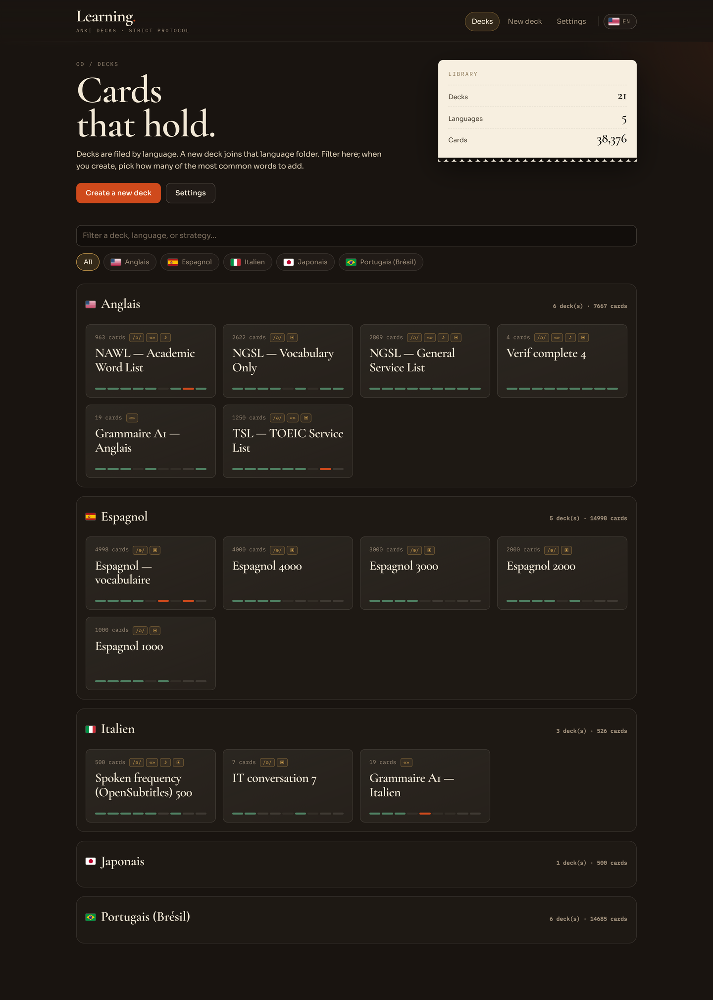
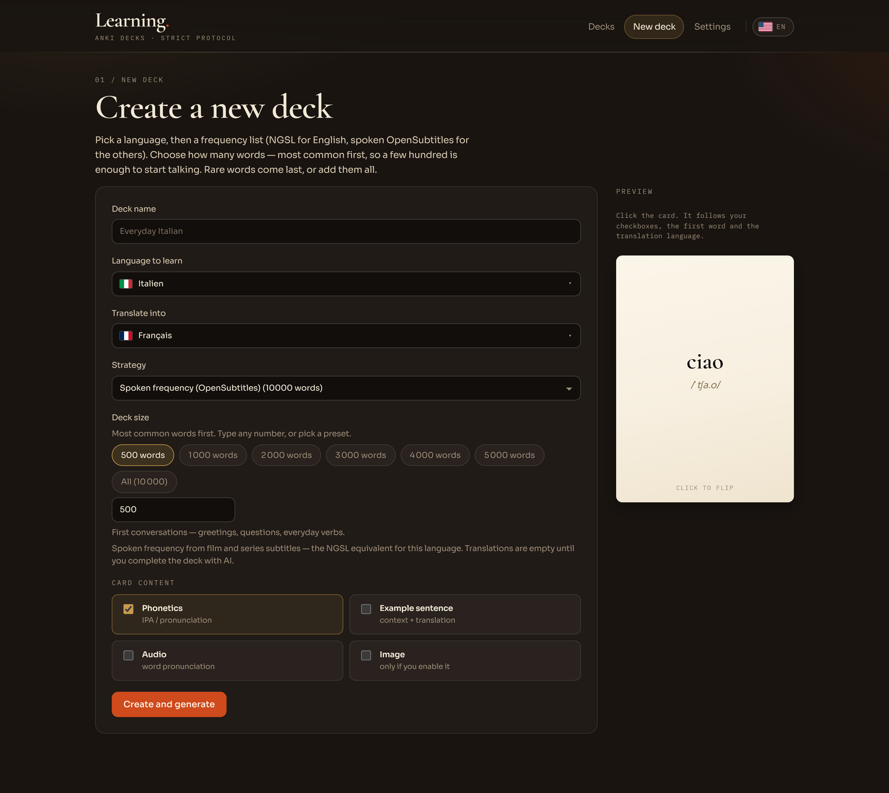
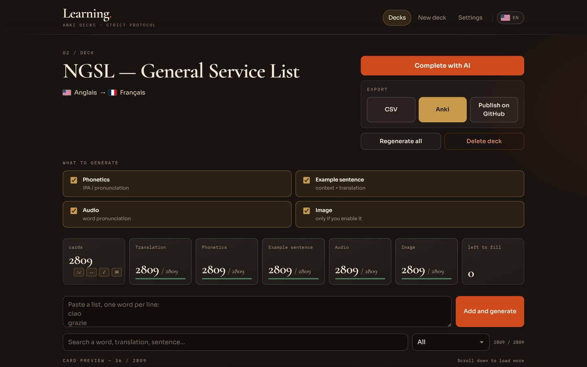
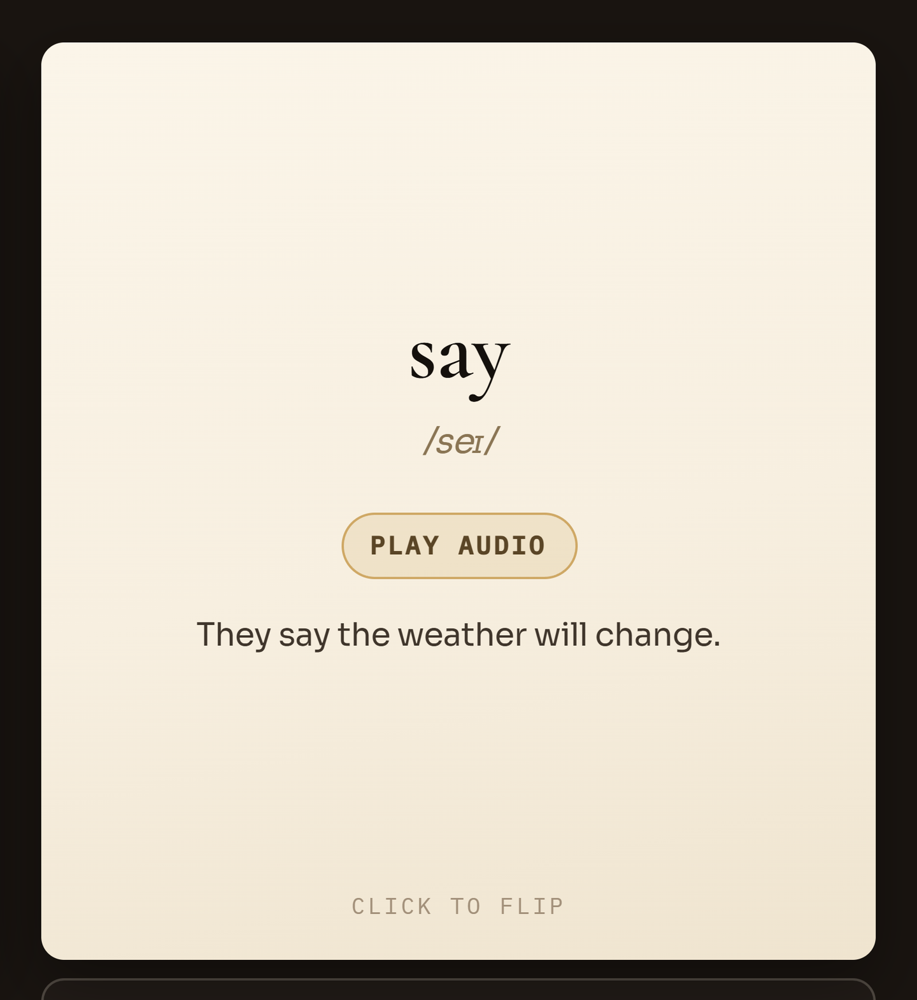

# Anki Learning

Turn a vocabulary list into an Anki deck you can read, hear, and review in both directions. Anki Learning gives you a local workspace to choose your words, edit their translations and examples, and check each card before it reaches Anki.

[Installation guide](docs/installation.md) · [Architecture](docs/ARCHITECTURE.md)



## Features

- **41 frequency lists**, plus English NGSL, TSL, and NAWL resources, with a deck size of your choice.
- **Customizable cards** with source and translation languages, phonetics, example sentences, audio, and images.
- **Incremental enrichment** that fills missing fields while keeping every card manually editable.
- **Multiple providers**: Claude, Codex, and Grok for text; Wikimedia, Unsplash, Pexels, Grok Imagine, and Codex for images; Edge TTS for audio.
- **Anki and CSV exports**, direct delivery through AnkiConnect, and GitHub release uploads.
- **Five interface languages**: English, French, Spanish, Portuguese, and German.

The application and decks live on your machine. Generation, image search, and text-to-speech features use online services.

## Create your first deck

1. Open **New deck** and choose the language you want to learn and the translation language.
2. Select a source: spoken frequency, a specialized English list, or an available grammar strategy.
3. Choose the number of words. Frequency lists start with the most common words.
4. Enable the content you need: phonetics, example sentences, audio, and images.
5. Create the deck, then open the workshop to complete and review it.



You can also add your own words, one per line, from the workshop. Start with a small deck to check the results and provider settings before processing a full list.

## Review your cards

The workshop shows completed fields, missing content, and errors that need attention. **Complete with AI** enriches the deck; running it again fills fields that are still incomplete. Search for a card to edit its content manually.



Click a card to flip it and review both sides.

| Front | Back |
| --- | --- |
|  |  |

Processing follows nine stages:

```text
ingest → normalize → translate → phonetic → sentences → images → audio → qa → export
```

Pre-export checks depend on the features you enabled. Blocking errors prevent export; some issues, such as a missing illustration, remain warnings. Function words are deliberately left without images.

These checks validate content structure and completeness. Review translations and examples yourself to check their meaning and learning value.

## Configure services

### Text and images

Use **Settings** to choose the text provider, image source, and default translation language.

Learning can use an API key or a compatible local session opened with one of these tools:

| Provider | CLI login | API key variable |
| --- | --- | --- |
| Codex / OpenAI | `codex login` | `OPENAI_API_KEY` |
| Grok / xAI | `grok login` | `XAI_API_KEY` |

A configured API key takes priority over a local session. **Reconnect** runs the provider's login command, so its CLI must be installed. Service access depends on your account's permissions and quotas.

Wikimedia image search requires no key. Unsplash uses `UNSPLASH_ACCESS_KEY`, and Pexels uses `PEXELS_API_KEY`. Grok Imagine and the local Codex CLI can generate illustrations. The image library tracks their origin and reuses them by meaning and scene; see the [image guide](docs/image-library.md). You can customize the prompt and number of concurrent image requests.

Manual editing remains available without a connected text provider. A local sentence generator covers English, Spanish, and Portuguese, but does not replace a translation service for unknown words.

### Local data

Decks, settings, media, caches, and exports are stored in `studio/data/`, which is excluded from Git. Keys entered in the interface are saved in the local settings file: keep this directory private.

| Variable | Default | Purpose |
| --- | --- | --- |
| `LEARNING_DATA_DIR` | `studio/data` | Application data directory |
| `LEARNING_WEB_DIR` | Not set | Frontend build served by the API; set automatically by the launchers and Docker |
| `LEARNING_API` | `http://127.0.0.1:8700` | API target for the frontend development proxy |

## Export a deck

Once blocking checks pass, choose an export method:

| Output | Use |
| --- | --- |
| **Anki — `.apkg`** | Import into Anki with bundled media and cards in both directions |
| **CSV** | Reuse or edit the data in another tool |
| **AnkiConnect** | Send the deck directly to Anki running on your machine |
| **GitHub** | Upload the `.apkg` as a release asset |

Exports are saved in `studio/data/exports/`, or the `exports/` subdirectory of your custom data directory.

### Send to Anki

For direct delivery, see the [AnkiConnect setup guide](docs/installation.md#ankiconnect).

Keep Anki open and use the **Anki** button in the workshop. Decks are organized as `Language::Deck name`. The language page can send its decks in sequence; **Send all to Anki** processes every language. Failed decks remain visible and can be retried. Keep the browser tab open until the batch finishes.

You can also import the `.apkg` file manually in Anki.

### Publish on GitHub

Set the repository and release tag in **Settings**. **Publish all to GitHub** processes all decks sequentially and reports individual failures. New files upload before replacing existing release assets. Authentication uses `GITHUB_TOKEN`, `GH_TOKEN`, or an existing `gh auth login` session.
