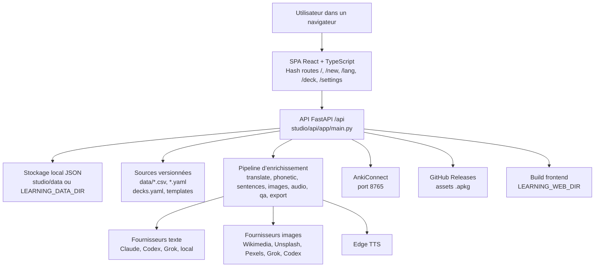
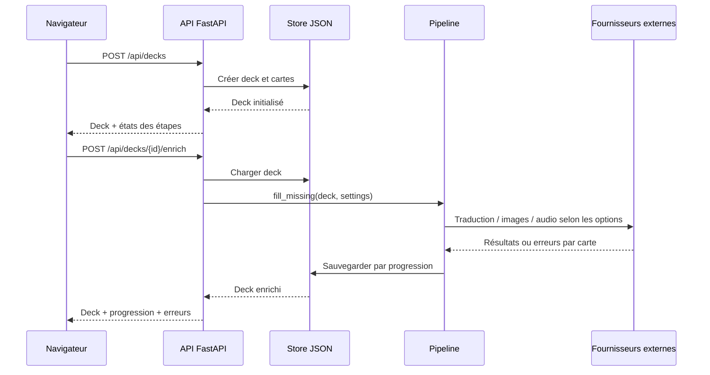
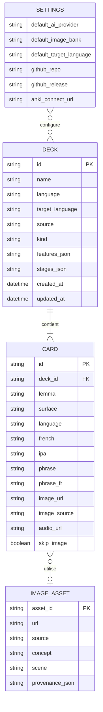

# Architecture d’Anki Learning

> État documenté à partir de `main` au 2 novembre 2026 (`5746070`). Ce document décrit l’architecture réellement présente dans le dépôt ; il ne remplace pas le guide d’installation ni les notes techniques de `studio/README.md`.

## 1. Objectif et périmètre

Anki Learning est une application locale qui transforme des listes de vocabulaire ou des stratégies de grammaire en decks Anki vérifiables. Elle permet de :

- sélectionner une langue, une source et une taille de deck, ou saisir ses propres mots ;
- enrichir les cartes avec traduction, phonétique, exemples, images et audio ;
- vérifier les cartes par étapes avant export ;
- exporter en `.apkg` ou CSV, envoyer vers AnkiConnect et publier des decks `.apkg` dans une release GitHub ;
- gérer les images et leur provenance dans une bibliothèque locale.

Les decks, médias, réglages et exports restent sur la machine de l’utilisateur. Les fournisseurs d’IA, de recherche d’images, de synthèse vocale, GitHub et AnkiConnect sont des intégrations externes optionnelles.

## 2. Architecture globale

L’application est un monolithe local composé d’une SPA React/Vite et d’une API FastAPI. En développement, Vite sert l’interface sur `5173` et relaie les appels `/api` vers l’API sur `8700`. En exécution locale ou dans Docker, FastAPI peut servir le build statique depuis `LEARNING_WEB_DIR`.

### Responsabilités principales

| Brique                | Responsabilité                                                                      | Emplacement                                             |
| --------------------- | ----------------------------------------------------------------------------------- | ------------------------------------------------------- |
| Interface             | Navigation, création de decks, atelier de correction, réglages, actions Anki/GitHub | `studio/web/src/`                                       |
| API                   | Contrats HTTP, orchestration des opérations et sérialisation des écritures par deck | `studio/api/app/main.py`                                |
| Modèles               | Modèles Pydantic des decks, cartes, réglages et requêtes                            | `studio/api/app/models.py`                              |
| Store                 | Lecture/écriture atomique des decks et réglages, calcul des statistiques            | `studio/api/app/store.py`                               |
| Pipeline              | Enrichissement par étapes, reprise des champs manquants, QA                         | `studio/api/app/pipeline.py`, `protocol.py`             |
| Catalogue/legacy      | Langues, listes de fréquence, stratégies de grammaire et import initial             | `catalog.py`, `frequency.py`, `legacy.py`, `lexicon.py` |
| Éditeur               | Ajout, modification, renommage et suppression de cartes/decks                       | `editor.py`                                             |
| Bibliothèque d’images | Recherche, cache, provenance, remplacements et sauvegardes                          | `cache.py`, `image_library.py`, `image_operations.py`   |
| Exports               | CSV et paquet Anki avec médias, GUID et modèle à sept champs                        | `services/export.py`                                    |
| Publication           | AnkiConnect et assets de releases GitHub                                            | `services/publish.py`                                   |
| Lancement             | Création de l’environnement, installation, build frontend et démarrage Uvicorn      | `scripts/launch.py`, `start.*`                          |

## 3. Interfaces et flux importants

### Création et enrichissement d’un deck

1. La SPA envoie `POST /api/decks` avec une source (`source_id`) ou une liste de mots.
2. L’API résout la langue, construit les cartes et initialise les étapes dans le modèle `Deck`.
3. Le chargement ou l’enrichissement applique la normalisation et le cache lexicographique.
4. `POST /api/decks/{id}/enrich` appelle `pipeline.fill_missing` pour ne remplir que les champs incomplets. La concurrence est limitée et les écritures d’un même deck sont sérialisées par un verrou asyncio.
5. Chaque étape conserve un état `pending`, `running`, `passed`, `failed`, `blocked` ou `skipped`, ainsi que ses erreurs.

### QA et export

Les exports réutilisent le QA du protocole. Un export est refusé lorsqu’une erreur bloquante subsiste ; l’export CSV s’assure également que l’étape `export` est passée. Le paquet Anki conserve les GUID dérivés de l’identifiant du deck et de la carte afin que les renvois vers Anki puissent mettre à jour les notes existantes.

### Publication et AnkiConnect

- `POST /api/decks/{id}/anki` exporte et envoie un deck à AnkiConnect ; les noms suivent `Langue::Nom du deck`.
- Les routes `/api/decks/{id}/publish` publient un `.apkg` dans la release GitHub configurée.
- Les routes `/api/languages/{lang_id}/publish` regroupent plusieurs decks d’une langue en mode assets séparés ou archive ZIP.
- Les tokens GitHub peuvent venir de l’environnement (`GITHUB_TOKEN`/`GH_TOKEN`) ou de `gh auth token` en exécution locale. Le conteneur Docker ne fournit pas les sessions CLI de l’hôte.

### API principale

- Santé et métadonnées : `/api/health`, `/api/meta`.
- Réglages et sessions locales : `/api/settings`, `/api/auth/*`.
- Decks et cartes : `/api/decks`, `/api/decks/{id}`, routes `cards`, `enrich`, `run` et `qa`.
- Images : `/api/image-library/*`, `/api/decks/{id}/images/replace`.
- Exports : `/api/decks/{id}/export/csv`, `/api/decks/{id}/export/apkg`.
- Anki/GitHub : `/api/anki/*`, `/api/publish/*`, routes `publish` par deck et par langue.
- Médias locaux : `/api/legacy-audio/*`, `/api/cache-media/*`, `/api/media/*`, `/api/exports/*`.

## 4. Modèle de données et persistance

Il n’y a pas de base relationnelle pour les decks. Le modèle conceptuel ci-dessous est matérialisé par des fichiers JSON et une base SQLite spécialisée pour la bibliothèque d’images.

`SETTINGS` et `DECK` ne sont pas des tables ; leurs relations dans le diagramme décrivent seulement les dépendances fonctionnelles.

| Chemin                              | Contenu                                                            | Versionné ? |
| ----------------------------------- | ------------------------------------------------------------------ | ----------- |
| `studio/data/decks/<id>.json`       | Deck complet, cartes, états et erreurs                             | Non         |
| `studio/data/settings.json`         | Fournisseurs, réglages et clés saisies dans l’interface            | Non         |
| `studio/data/media/<deck_id>/`      | Images et audio d’un deck                                          | Non         |
| `studio/data/cache/`                | Glossaires, scènes et médias partagés                              | Non         |
| `studio/data/image-library.sqlite3` | Provenance, contextes et historique de la bibliothèque d’images    | Non         |
| `studio/data/image-backups/`        | Sauvegardes avant remplacement ou migration                        | Non         |
| `studio/data/exports/`              | `.apkg` et `.csv` générés                                          | Non         |
| `data/`                             | Listes de fréquence, ressources de grammaire et audio de référence | Oui         |
| `templates/`                        | Modèles HTML/CSS de cartes                                         | Oui         |

Les écritures de decks passent par un fichier temporaire puis `os.replace`. Le répertoire de données peut être déplacé par `LEARNING_DATA_DIR`, ce qui permet d’isoler plusieurs instances.

## 5. Runtime, déploiement et configuration

### Lancement local

- Prérequis : Python 3.10+ avec `venv`, Node.js 22.18+ et npm.
- `start.sh`, `start.ps1` et `start.cmd` délèguent à `scripts/launch.py`.
- Le launcher crée/réutilise `.venv/`, installe `studio/api/requirements.txt`, exécute `npm ci`, construit `studio/web` et démarre Uvicorn.
- L’interface et l’API sont exposées localement sur `http://127.0.0.1:8700`; le serveur Vite de développement utilise `5173`.

### Docker Compose

Le `Dockerfile` utilise deux étapes : Node 22 pour compiler la SPA, puis Python 3.12 pour l’image runtime. Le conteneur lance Uvicorn sur `0.0.0.0:8700`, expose un healthcheck `/api/health` et monte le volume nommé `learning-data` sur `/var/lib/learning`. `compose.yaml` publie le port uniquement sur `127.0.0.1` et redémarre le service sauf arrêt explicite.

Variables utiles :

- `LEARNING_DATA_DIR` : racine des données persistantes ; dans Docker, `/var/lib/learning` ;
- `LEARNING_WEB_DIR` : build statique servi par l’API ;
- `LEARNING_API` : cible du proxy Vite, par défaut `http://127.0.0.1:8700` ;
- clés `ANTHROPIC_API_KEY`, `OPENAI_API_KEY`, `XAI_API_KEY`, `UNSPLASH_ACCESS_KEY`, `PEXELS_API_KEY` ;
- `GITHUB_TOKEN` ou `GH_TOKEN` pour les publications ;
- `LEARNING_PORT` pour le port publié par Compose.

## 6. Limites et points ouverts

- L’application n’a pas d’authentification utilisateur intégrée. Le guide d’installation recommande de rester en local ou d’ajouter une authentification devant l’application avant tout hébergement distant.
- Les clés saisies dans Settings sont persistées dans le fichier local de réglages ; les sauvegardes doivent donc rester privées.
- Les images générées ou réutilisées sont suivies par provenance, mais la vérification du contenu visuel reste une revue humaine.
- Les sessions CLI (`claude`, `codex`, `grok`, `gh`) sont réutilisables par le launcher local mais ne sont pas disponibles dans l’image Docker ; il faut alors utiliser des clés/API et un token GitHub.
- Les écritures concurrentes d’un même deck sont sérialisées dans un processus API, mais plusieurs instances doivent utiliser des répertoires `LEARNING_DATA_DIR` distincts pour éviter les collisions.
- Le démarrage importe les anciens decks `legacy-*.json` depuis les CSV de `data/`. Les corrections relues sont ensuite stockées dans les JSON locaux : la stratégie de sauvegarde doit couvrir ces JSON, les médias, la bibliothèque SQLite et les exports.
- Aucun PRD, fichier `SPEC`, plan produit ou directive `AGENTS.md`/`CLAUDE.md` n’est présent dans le dépôt au moment de cette revue ; les décisions produit restent donc principalement portées par le README, le guide d’installation et les notes techniques.

## 7. Références internes

- [README](../README.md) — parcours utilisateur et capacités principales.
- [Guide d’installation](installation.md) — lancement local, Docker, stockage et réseau.
- [Notes techniques de Studio](../studio/README.md) — enrichissement, images, exports, publication et données locales.
